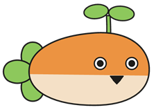

# 麦麦钢管

让麦麦被点击后发出钢管叫声。

- 点击桌宠播放钢管音效，连续点击时声音可以重叠。
- 在桌宠的「插件扩展 → 钢管音量」中调节音量，默认音量为 1%。
- 提起并拖动桌宠一段时间后，会掉落一只小麦麦。

## 使用

在插件市场安装「麦麦钢管」，并在 WebUI 的桌宠设置中启用桌宠。插件设置中可以调整掉落效果，也可以分别关闭掉落和点击音效。

支持 Windows，需要 MaiBot 1.3.19 或更新版本、SDK 2.20.0 或更新版本，以及 WebView2 Runtime。

代码使用 MIT 许可证，素材来源见 [ASSETS.md](ASSETS.md)。
